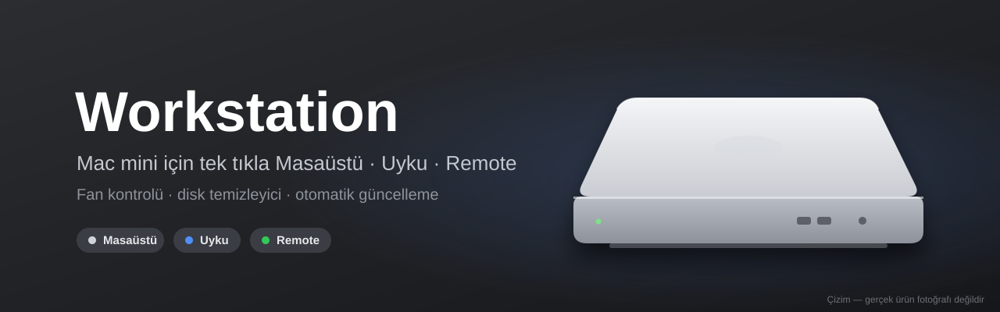
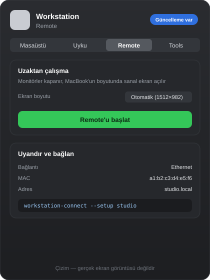
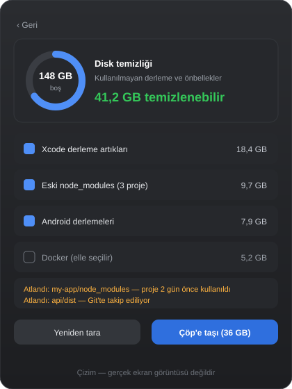
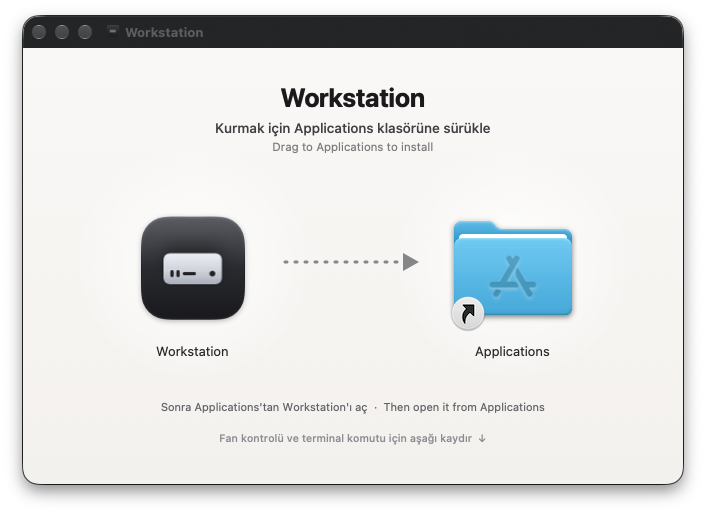
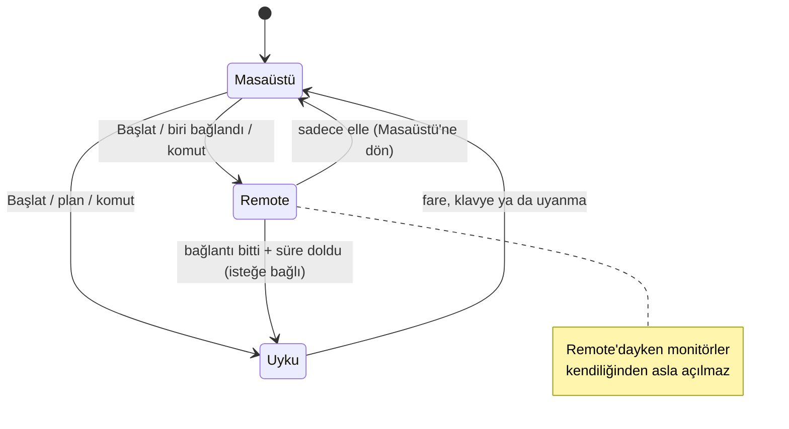
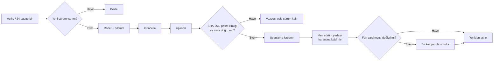

<p align="center">
  
</p>

<p align="center">
  <a href="https://github.com/Tolgahan0/workstation/releases/latest"></a>
  
  
  
  <a href="LICENSE"></a>
</p>

# Workstation

🌐 **Web sitesi:** [tolgahan0.github.io/workstation](https://tolgahan0.github.io/workstation/) (Türkçe / English)

**Mac mini'ni tek tıkla işe, uykuya ya da uzaktan çalışmaya hazırlayan menü çubuğu uygulaması.**
Monitörleri kapatıp açar, MacBook'tan bağlanınca doğru boyutta bir ekran hazırlar, fanları yönetir, geliştirici araçlarının şişirdiği diski güvenle temizler ve kendini günceller.

> Görseller **çizimdir**; gerçek ekran görüntüleri yakında [`docs/screenshots/`](docs/screenshots/) klasörüne eklenecek.

<p align="center">
  
  &nbsp;&nbsp;
  
</p>

## Neler yapar?

| | | |
|---|---|---|
| 🖥️ **Masaüstü** <br> Monitörler açılır, her biri son parlaklığıyla gelir. | 🌙 **Uyku** <br> Monitörler kapanır, Mac az enerjiyle dinlenir. | 🛰️ **Remote** <br> Monitörler kapanır, MacBook'un boyutunda sanal ekran açılır. |
| 🌀 **Fan kontrolü** <br> Otomatik · Yarım · Tam hız; ısınınca kendiliğinden güvenli moda geçer. | 🧹 **Disk temizleyici** <br> Eski derlemeler, önbellekler, yapay zekâ araçlarının artıkları. Kullanılan hiçbir şeye dokunmaz. | ⬆️ **Otomatik güncelleme** <br> Yeni sürüm çıkınca haber verir, istersen kendisi kurar. |
| 📡 **Uyandır ve bağlan** <br> MacBook'tan tek komutla uyandır, Remote'a al, Ekran Paylaşımı'nı aç. | ⏰ **Zamanlama ve otomasyon** <br> Belli saatlerde mod değiştir; biri bağlanınca Remote'a geç. | 🔗 **Kestirmeler ve terminal** <br> `workstation://` adresleri ve `workstation` komutu. |

Boştayken arka planda dönen bir şey yok: her şey bir olay olunca (uyanma, bağlantı, zamanı gelen bir plan) çalışır. Yeni özelliklerin hepsi **varsayılan olarak kapalıdır**.

## Kurulum

### Kolay yol: DMG (önerilen)

<p align="center"></p>

1. [Son sürümü](https://github.com/Tolgahan0/workstation/releases/latest) aç, `Workstation-<sürüm>.dmg` dosyasını indir ve aç.
2. **Workstation**'ı sağdaki **Applications** klasörüne sürükle.
3. Applications'ta Workstation'a **sağ tıkla › Aç**. İlk seferde macOS "geliştirici doğrulanamadı" diyebilir; yine **Aç**'a bas. Menü çubuğunda Mac mini simgesi belirir.
4. **Önerilir — bir kez:** DMG penceresinde **aşağı kaydır**, **`Kurulum.command`** dosyasına **sağ tıkla › Aç**. Mac parolan bir kez sorulur ve şunlar kurulur:
   - fan kontrolü (`wm-fanhelper` yardımcısı),
   - parolasız mod geçişi (`pmset` için sudoers kuralı; bu olmadan Uyku/Remote'un güç ayarları uygulanamaz),
   - `workstation` / `workstation-connect` komutları (`ssh studio workstation remote`),
   - açılışta otomatik başlatma.

   Sürükleyerek kurduğunda uygulama bunları kendisi kurmaz; fan kartı "kurulumu bir kez daha çalıştır" der. `Kurulum.command` uygulamayı Applications'a da kopyaladığı için 2–3. adımları atlayıp doğrudan onu da kullanabilirsin. DMG elinde değilse aynı adım: `/Applications/Workstation.app/Contents/Resources/postinstall.sh`

> **"Açılamıyor" uyarısı mı çıktı?** Uygulama Apple'a ücretli geliştirici hesabıyla imzalatılmadı. Şunlardan biri yeter:
> - Sistem Ayarları › Gizlilik ve Güvenlik › en altta **"Yine de Aç"**
> - ya da Terminal'de: `xattr -dr com.apple.quarantine /Applications/Workstation.app`

### Kaynaktan

Yalnızca Xcode Command Line Tools gerekir (Xcode gerekmez):

```bash
git clone https://github.com/Tolgahan0/workstation.git && cd workstation
./install.sh      # sudo olmadan çalıştır; parola bir kez sorulur
```

`install.sh` → BetterDisplay'i hazırlar → `build.sh` ile derler → `/Applications/Workstation.app`'e kopyalar → fan yardımcısını, komutları ve açılış öğesini kurar. Eski adıyla kurulmuş **WorkstationMode.app** ve giriş öğesi otomatik kaldırılır; ayarların korunur.

## Kullanım

Menü çubuğundaki Mac mini simgesine tıkla. Simgenin köşesindeki nokta modu gösterir:
yok = **Masaüstü** · mavi = **Uyku** · yeşil = **Remote** · sarı = geçiş sürüyor.

Uyku ve Remote başlamadan önce ekranda kısa bir geri sayım çıkar; **İptal** ya da **Esc** ile vazgeçebilirsin.



## Uzaktan çalışma (Remote) kurulumu

1. **Mac mini'de:** Sistem Ayarları › Genel › Paylaşma › **Uzaktan Giriş** ve **Ekran Paylaşımı**'nı aç.
2. **MacBook'ta** bir kez `~/.ssh/config` içine bir takma ad ekle (ör. `studio`), sonra:

```bash
workstation-connect --setup studio   # Mac mini'nin MAC adresini kaydeder (Mac mini uyanıkken)
workstation-connect                  # uyandır → bekle → Remote → Ekran Paylaşımı
```

- Uyandırma kablolu ağda (Ethernet) en güveniliridir; Remote sekmesindeki **Uyandır ve bağlan** kartı bağlantı türünü ve gerçek MAC adresini gösterir.
- Sanal ekran için [BetterDisplay](https://github.com/waydabber/BetterDisplay) kullanılır; yoksa uygulama ilk Remote'ta kendisi kurar. BetterDisplay'de bir kez **Settings › Integration › CLI** erişimini aç.

## Tools

### Fan
**Otomatik** (macOS yönetir) · **Yarım** · **Tam hız**. Mac 95 °C'yi geçerse fanlar kendiliğinden tam hıza çıkar; uygulama kapanınca ya da çökerse fanlar her zaman macOS'a geri bırakılır.

### Sistem
İşlemci, bellek, disk ve ağ özetleri; **Uyanık tut** (1 sa · 3 sa · kapatana dek). Yalnızca panel açıkken ölçülür.

### Disk temizleyici
Xcode, Android, JavaScript, CocoaPods, Homebrew, Docker, Python/Rust/Go ve Claude/Cursor gibi yapay zekâ araçlarının bıraktığı artıkları bulur. **Önce listeler, sen onaylayınca temizler.** Tools sekmesinde kendi kartı var: **Tara** ile elle tarama, hemen altındaki **Otomatik temizlik** kartından açma/kapama, günlük saat ve "disk dolunca" tetikleyicisi.

**Güvenlik kuralları — hepsi her silmeden hemen önce yeniden kontrol edilir:**

| Kural | Ne demek |
|---|---|
| 🔒 Açık dosya yok | `lsof` ile o anda açık olan dosyası olan klasörlere dokunulmaz. |
| 🏃 Çalışan program yok | İçinde çalışan bir programın bulunduğu klasörler atlanır. |
| 🕒 Proje dinleniyor | Yakın zamanda üzerinde çalışılan projelerin çıktıları silinmez (derlemeler için 7, `node_modules` için 14 gün; ayarlanabilir). |
| 🌿 Git'e saygı | Git'te takip edilen hiçbir dosya silinmez; `dist` gibi klasörler ancak `.gitignore`'daysa temizlenir. |
| 🗑️ Önce Çöp | Varsayılan olarak her şey **Çöp Sepeti**'ne gider. Önbellekler için isteğe bağlı **Kalıcı sil**. |
| 🚫 Dokunulmazlar | Ev klasörü, `~/Library`, `.ssh`, anahtar zinciri, `.git`, `.env`, Claude ayarları/hafızası… ve senin **Asla dokunma** listen. |
| 🔗 Kısayol izlenmez | Sembolik bağlantıların hedefine asla gidilmez. |
| 📝 Kayıt | Her temizlik `~/Library/Application Support/Workstation/cleaner-history.json` ve günlüğe yazılır. |

**Otomatik temizlik** varsayılan olarak **kapalıdır**. Açarsan günde bir kez (varsayılan 04:00) ya da disk 20 GB / %10'un altına inince çalışır; pil %30'un altındaysa veya işlemci yoğunsa bekler. Otomatik modda yalnızca güvenli küme temizlenir: Xcode derleme artıkları, kullanılmayan simülatörler, Homebrew önbelleği, Android ve JS derleme çıktıları, npm/pnpm/uv önbellekleri. Docker, Çöp Sepeti, uygulama önbellekleri ve Xcode arşivleri **yalnızca sen seçersen** temizlenir.

> Çöp'e taşınan dosyalar Çöp boşaltılana kadar yer kaplamaya devam eder.

## Adresler ve komutlar

| İş | Kestirme / URL | Terminal (yerelde ya da `ssh studio …`) |
|---|---|---|
| Masaüstü / Uyku | `workstation://desktop` · `workstation://sleep` | `workstation desktop` · `workstation sleep` |
| Remote | `workstation://remote?res=1512x982` · `?preset=mbp16` | `workstation remote 1512x982` · `workstation remote mbp16` |
| Profil uygula | `workstation://profile/Kod` | `workstation profile Kod` |
| Fan | `workstation://fan/auto` · `/half` · `/max` | `workstation fan max` |
| Uyanık tut | `workstation://keepawake/on` · `/off` · `/3h` | `workstation keepawake 90m` |
| Disk taraması | `workstation://clean/scan` | `workstation clean --dry-run` |
| Otomatik temizlik | `workstation://clean/auto` | `workstation clean --auto` |
| Seçilenleri temizle | — | `workstation clean --yes` |
| Durum / günlük | — | `workstation status` · `workstation log` |

### Kestirmeler (Shortcuts)
Kestirmeler › yeni kestirme › **URL'yi Aç** → yukarıdaki adreslerden biri. Siri ile de çalışır ("Hey Siri, Remote").

## Otomatik güncelleme

Uygulama açılıştan kısa süre sonra ve günde bir kez GitHub'daki son sürüme bakar. Yeni sürüm varsa başlıkta **"Güncelleme var"** rozeti çıkar; **Ayarlar › Güncelleme › Güncelle**'ye basman yeter.



- **Otomatik güncelle** (varsayılan kapalı = sadece haber verir). Açıksa Remote modundayken kurulum yapılmaz.
- **Beta sürümleri** isteğe bağlıdır.
- Depo gizliyse Ayarlar'dan **GitHub anahtarı** ekle (yalnızca okuma izni yeter); anahtar macOS Anahtar Zinciri'nde saklanır.

## Sık sorulanlar

<details>
<summary><b>Remote "BetterDisplay CLI kapalı" diyor.</b></summary>

BetterDisplay › Settings › Application (Integration) bölümünde **CLI / URL scheme** erişimini aç. Uygulama bunu açılışta bir kez hatırlatır; kapalıyken güvenlik için monitörlerin kapatılmaz.
</details>

<details>
<summary><b>BetterDisplay Pro lisansı gerekiyor mu?</b></summary>

Monitörleri kapatmak için **hayır**; bunu Workstation kendisi yapar. Sanal ekran özelliği BetterDisplay'in ücretsiz sürümünde sınırlı olabilir. Sanal ekran açılamazsa Remote durur ve monitörlerin açık kalır.
</details>

<details>
<summary><b>Mod değişirken ekranlar neden bir an kararıyor?</b></summary>

Monitör kapatıp açmak macOS'un tüm ekran düzenini yeniden kurmasına yol açar; bu yüzden geçişte ekranlar bir iki saniye kararıp gelir. Bu normaldir, pencerelerin yerinde kalır.
</details>

<details>
<summary><b>Temizleyici Desktop/Documents için izin istiyor.</b></summary>

Projelerini bulmak için bu klasörlere bakar. İzin vermezsen o klasörler atlanır. Çöp Sepeti'ni temizlemek için **Tam Disk Erişimi** gerekir.
</details>

<details>
<summary><b>Fan modu yeniden başlatınca ne oluyor?</b></summary>

Mac her açılışta fanları macOS'a verir. Workstation açılınca seçtiğin modu yeniden uygular.
</details>

## Kaldırma

```bash
osascript -e 'tell application "System Events" to delete login item "Workstation"'
sudo /usr/local/libexec/wm-fanhelper reset     # fanları macOS'a bırak
sudo pmset repeat cancel                        # yalnızca "Planlı uyanma"yı açtıysan
pkill -x Workstation; rm -rf /Applications/Workstation.app
sudo rm -f /etc/sudoers.d/workstation_toggle /usr/local/bin/workstation /usr/local/bin/workstation-connect \
           /usr/local/libexec/wm-fanhelper /usr/local/libexec/wm-fanhelper.version
defaults delete com.tolgahanayaz.workstationmode
security delete-generic-password -s com.tolgahanayaz.workstation.github 2>/dev/null   # GitHub anahtarı
rm -rf ~/Library/Application\ Support/Workstation ~/Library/Logs/Workstation.log*
rm -rf ~/.config/workstation                    # MacBook'ta (workstation-connect ayarı)
```

## Geliştirme ve yayın

```bash
./build.sh                         # build/Workstation.app (bu Mac'in mimarisi)
./build.sh --universal --version 1.8.0 --build 42
Tests/run-tests.sh                 # çekirdek testleri (macOS ya da Linux)
```

- Kod yalnızca **Command Line Tools** ile derlenir; bu yüzden SwiftUI makroları (`@State`, `@Observable`, `#Preview`) kullanılmaz.
- **Yeni sürüm yayınlamak:** `Info.plist` sürümünü artır, commit'le, sonra

  ```bash
  git tag v1.9.0 && git push origin v1.9.0
  ```

  GitHub Actions ([`release.yml`](.github/workflows/release.yml)) testleri çalıştırır, evrensel derler ve sürüme `Workstation-<sürüm>.dmg`, `.zip`, `SHA256SUMS.txt` ve `latest.json` ekler. Sürüm adında `-` varsa (ör. `v1.9.0-beta.1`) beta olarak yayınlanır.
- İç işleyiş, ayrıntılı ayarlar ve sınırlamalar: [`docs/TECHNICAL.md`](docs/TECHNICAL.md).

## Web sitesi (Vercel)

`site/` derleme adımı olmayan statik bir sitedir (HTML/CSS/JS). Şu an GitHub Pages'te yayında
([`pages.yml`](.github/workflows/pages.yml)); aynı klasör Vercel'e de olduğu gibi konabilir:

1. [vercel.com/new](https://vercel.com/new) › bu depoyu içe aktar.
2. **Framework Preset:** Other · **Root Directory:** `site` · **Build Command:** boş · **Output Directory:** boş (ya da `.`).
   Alternatif: Root Directory'yi depo kökü bırak; kökteki [`vercel.json`](vercel.json) `outputDirectory: "site"` ile aynı sonucu verir.
3. Deploy. Her `main` push'u otomatik yayınlanır.

## Dil

Arayüz, menü, bildirimler, HUD ve CLI macOS'un ilk tercih edilen dili Türkçe ise Türkçe, değilse İngilizcedir
(Sistem Ayarları › Genel › Dil ve Bölge). Denemek için: `WORKSTATION_LANG=en open -a Workstation` ya da `WORKSTATION_LANG=en workstation`.
Günlük (log) satırları tanı amaçlı olduğu için Türkçe kalır.

## Lisans

[GNU GPL v3.0](LICENSE) © 2026 Tolgahan Ayaz. Bu programı GPL-3.0 koşullarıyla dağıtabilir ve değiştirebilirsin;
türetilmiş sürümler de aynı lisansla, kaynak koduyla birlikte dağıtılmalıdır.

---

### English summary

**Workstation** is a macOS menu bar app for a Mac mini that switches between **Desktop**, **Sleep** and **Remote** modes in one click. Remote turns off the physical monitors and creates a HiDPI virtual display sized to the connecting MacBook. It also includes fan control, a **safe developer disk cleaner** and an **auto-updater** that works through GitHub Releases. The cleaner re-checks open files, running processes, git-tracked files and project activity right before each delete, and moves items to the Trash by default. The updater verifies SHA-256, bundle id and code signature before it swaps the app. Website: https://tolgahan0.github.io/workstation/. Install from the DMG on the [Releases](https://github.com/Tolgahan0/workstation/releases) page: drag Workstation to Applications, right-click › Open, then run `Kurulum.command` once for fan control, password-less mode switching and the CLI, or run `./install.sh` from source (Command Line Tools only). Publish a release by pushing a `v*` tag. The UI, menu, notifications and CLI are English unless the first preferred macOS language is Turkish. The `site/` folder is a static site that deploys to Vercel with Root Directory `site` and no build step. Licensed under GPL-3.0.
